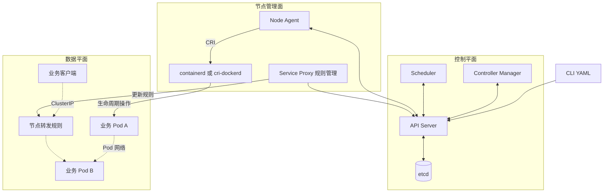
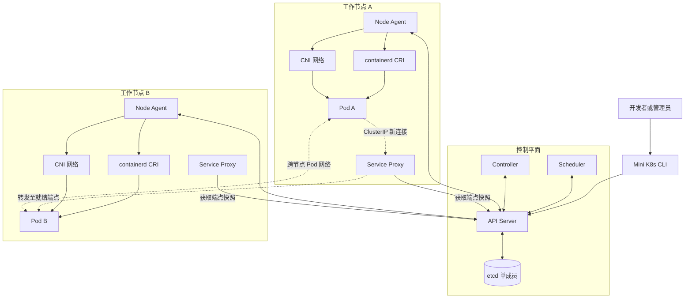
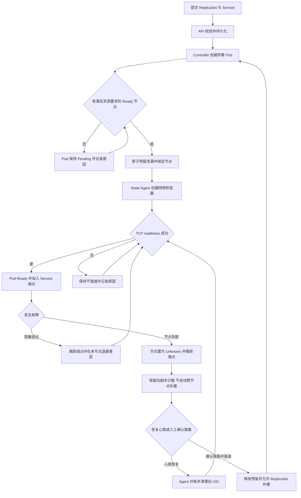

# Mini K8s 基础实现产品需求文档

团队原型  |  v0.1  |  2026年11月3日  |  待评审

### 01 产品定位

构建可运行的轻量容器编排原型，让团队通过声明式配置，在多个 Linux 节点上部署无状态服务，完成调度、运行状态同步、副本维持和稳定入口访问。首版以端到端闭环和故障行为可解释为交付标准。

本原型借鉴 Kubernetes 的资源模型与控制循环，自行实现编排逻辑，复用现成容器运行时、状态存储和基础网络工具。不作为生产集群，也不承诺 Kubernetes API 或 kubectl 兼容。[1]

### 目标用户与核心价值

| 用户 | 需要完成的任务 | 交付价值 |
| --- | --- | --- |
| 应用开发者 | 提交配置、调整副本、查看状态与日志 | 无需逐台启动和维护容器 |
| 平台开发者 | 验证控制循环、调度与网络方案 | 获得可扩展的编排原型 |
| 测试与评审人员 | 执行故障注入与完整演示 | 通过确定性场景判断是否达标 |

### 首版成功标准

- 在 1 个控制平面与 2 个工作节点上，完成 20 个单容器 Pod 的创建、调度、服务访问、伸缩和删除。

- 本地容器退出能够恢复；组件重启能够对账；节点失联能够被发现并从服务端点中排除。

- 每个关键失败都能通过状态原因、事件或日志定位，不以人工修改数据库完成演示。

### 文档使用约定

P0 为首版发布门槛，P1 为后续扩展。文中的架构选型、容量与时间数值为本次评审的建议基线，不代表已实测结果；实际性能需按第 7 章的固定环境验证。负责人、工期与依赖版本在评审后登记。

## 02 场景与首版边界

### 关键用户场景

- 发布服务：开发者提交 2 副本 ReplicaSet 与 Service，查看 Pod 从 Pending 到 Running，确认 Ready 后通过 ClusterIP 访问。

- 调整容量：将 replicas 从 2 改为 4，再缩为 1；系统收敛到目标数量并清理多余运行时资源。

- 排查异常：镜像拉取失败或容器持续退出时，开发者能看到原因、重试状态、重启计数及最近事件。

- 验证恢复：终止容器、重启 Agent 或断开节点连接，观察系统按约定恢复或进入可解释的降级状态。

### 功能范围

| 编号 | P0 必做能力 | 范围限制 |
| --- | --- | --- |
| FR01 | API 与持久化 | 资源校验、版本冲突、List 与 Watch、删除回收 |
| FR02 | 节点管理 | 注册、心跳、Ready 与 Unknown、容量上报 |
| FR03 | Pod 生命周期 | 单容器、Always、TCP readiness、日志读取 |
| FR04 | 资源调度 | CPU 与内存 requests、资源预留、一次性绑定 |
| FR05 | ReplicaSet | 创建、伸缩、补副本、级联删除 |
| FR06 | Pod 网络 | IPv4、跨节点双向可达、IP 分配与回收 |
| FR07 | Service | 单 TCP 端口 ClusterIP、selector、就绪端点 |
| FR08 | CLI 与诊断 | apply、get、describe、delete、scale、logs、events |
| FR09 | 恢复与对账 | 断线重连、组件重启、节点人工确认驱逐 |
| FR10 | 基本安全与运维 | TLS、身份范围校验、健康检查、备份恢复 |

### 首版不包含

Deployment 与滚动更新、Job、StatefulSet、多容器 Pod、Init Container、PV 与持久卷、Secret、ConfigMap、Ingress、DNS、NodePort、负载均衡器、网络策略、多租户、自动扩缩容、控制平面高可用和 Web 控制台均列为 P1 或后续独立规划。

仅支持 default 命名空间、公开或预置镜像和无状态应用。更换镜像使用新建 ReplicaSet，再手工切换 Service selector；首版不提供无损发布承诺。

## 03 系统边界与资源契约

### 控制平面与数据平面边界

控制平面负责接收期望状态、维护资源、对账、调度和决定服务端点。节点上的 Agent、运行时与 Proxy 的规则管理部分属于节点管理面：它们通过 API 获取配置并上报观察结果。数据平面是实际运行中的业务容器、Pod 网络与已下发的 Service 转发规则；业务流量不经过 API Server、Controller 或 Scheduler。Proxy 的控制逻辑下发规则，内核按规则转发数据流，两者职责分离。

业务流量不依赖控制面逐请求参与：控制面短暂不可用时，已运行容器和已下发规则尽力继续工作。此时不保证端点、新建、调度或状态及时更新，已有连接与故障后的可用性不作额外保证。节点与控制面之间的认证、配置和状态通道是管理通信，不能把它当作业务转发通道。

### 模块操作与依赖契约

| 模块 | 输入与主要操作 | 唯一允许的写入或副作用 | 不负责 |
| --- | --- | --- | --- |
| CLI | 解析 YAML，提交、查询、伸缩、删除 | 调用 API；不直接访问数据库或节点 | 调度、创建容器 |
| API Server | 鉴权、校验、List/Watch、CAS、bind、status、审计 | 唯一业务存储写入方；验证字段所有权、版本、会话与状态迁移 | 决定期望副本、选择节点、运行容器 |
| Controller Manager | 观察 RS、Pod、Node 和 Service；计算差异、创建/删除 Pod、维护节点与端点状态 | 仅通过 API 写自身管理的资源和状态；持有单活代次 | 直接访问 etcd、CRI 或宿主网络 |
| Scheduler | 观察待绑定 Pod 和节点资源，过滤、排序、请求绑定 | 调用 API 原子绑定并预留；禁止直接写 Node 或操作运行时 | 副本数量、节点容器创建 |
| Node Agent | 注册/心跳、观察本节点分配、CRI 对账、探针、status 与审计 | 仅操作本节点 CRI；调用 API 写授权状态；经 CNI 集成设置本节点网络 | 自主调度、写入其他节点状态 |
| Service Proxy | 获取 Service 和可用端点，比较期望与现有规则 | 仅维护本项目专属转发规则及本地状态 | 改动其他程序规则、生成业务副本 |
| CRI / CNI | 实现容器、sandbox 生命周期与 Pod 网络基础能力 | 各自管理本节点运行时或网络资源 | 实现调度、期望状态和全局对账 |

各组件只依赖资源契约及明确的客户端接口；先用 Go 包与小型接口划分职责，再按实际需要拆进程，不引入额外消息总线或通用插件框架。控制面模块可同进程部署，但必须通过 API 的同一校验与授权语义操作数据，不能以共享内存绕过存储事务。

### 关键操作幂等契约

| 操作 | 身份、重复行为与确认方式 |
| --- | --- |
| 用户创建或 apply | 指定请求操作 ID、资源名称及期望摘要；同 ID 同请求返回既有结果，复用 ID 携带不同内容拒绝。更新必须带版本；Pod spec 不可变 |
| Controller 创建与删除 | 创建使用持久化操作 ID、确定性名称和同事务去重；超时以同 ID 查询/重试。删除以 UID 和删除标记为前提，重复删除返回当前状态，不影响同名新对象 |
| 调度绑定 | Pod UID、节点 UID、版本和请求 ID 一同比较；绑定与资源预留原子提交。重复相同请求返回既有绑定，过期或不同目标冲突不重复预留 |
| sandbox / 容器创建 | 以 Pod UID、容器角色和持久化操作 ID 查找并认领已有 CRI 资源；超时先列举核对再创建；清理只针对对应 UID，不能触碰同名新 Pod |
| 状态、探针与心跳 | 同事务校验 UID、当前会话代次和版本；重复同一观测安全，过期观测与非法终态迁移拒绝，不让旧 Ready 覆盖新状态 |
| Service 规则 | 按 Service UID 及期望版本比较当前规则并收敛；重复应用不增加重复规则，删除只移除本项目对应规则 |
| 人工驱逐与审计 | 隔离确认后以节点 UID、会话代次和操作 ID 原子栅栏及释放预留；重试返回既有结果。审计意图/结果按操作 ID 关联，恢复可补记录，不虚称跨存储精确一次 |

幂等以 API 返回和可观测副作用为验收对象，不等于跨进程、跨网络的 exactly-once。超时后的结果未知时先查询和对账，不能直接换 ID 重新执行；证据不足时保持未知并告警。节点实际停止依赖外部隔离，不能由会话栅栏单独证明。

CRI 本身不承诺按本项目的操作 ID 去重。Agent 必须保证同一节点的同一 Pod UID 只有一个本地执行者，并持久化操作阶段及资源标签；启动后先取得节点本地互斥并列举匹配的 sandbox/容器，确认已提交结果后再继续。超时或崩溃后若无法确认旧资源是否存在，则保持待核实、停止该 Pod 的再次创建并告警；不能依靠 ID 字段本身假定运行时提供 exactly-once。

### 推荐实现基线

推荐采用 Go 实现自研组件，使用单成员 etcd 保存集群状态，工作节点默认采用 containerd 的 CRI 接口；如使用 Docker Engine，必须通过 cri-dockerd 的 CRI 接口接入，不直接调用 Docker API。编排逻辑不调用现成 Kubernetes 控制平面。具体版本在阶段一冻结并写入环境清单。

| 组件 | 职责 | 写入边界 |
| --- | --- | --- |
| API Server | 校验、授权、持久化与订阅入口 | 唯一可访问 etcd 的业务组件 |
| Scheduler | 筛选节点、预留资源、绑定 Pod | 通过 API 提交绑定事务 |
| Controller | 维持副本、计算端点、检测失联 | 通过 API 更新受控资源 |
| Node Agent | 运行容器、探测、日志与心跳 | 只回报本节点与已分配 Pod 的状态 |
| Service Proxy | 同步各节点 ClusterIP 转发规则 | 维护自身规则，不直写存储 |
| CLI | 提交配置、查询状态、诊断与伸缩 | 使用管理员凭据调用 API |

数据流：CLI → API → etcd；Scheduler 与 Controller 通过 API 观察并更新期望状态；Agent 通过 API 获取本节点任务，并驱动 CRI 与网络。Service Proxy 获取计算后的端点快照。组件可合并部署，逻辑职责仍保持清晰。[1]

### 系统架构图

实线表示控制或状态交互，虚线表示业务流量。两个工作节点采用相同组件；图中的 Pod 和 Service Proxy 为示意实例。

### 资源与一致性约束

- 所有持久化对象带 kind、apiVersion、metadata.name、uid、resourceVersion；用户声明 spec，系统上报 status。命名作用域内名称唯一，UID 每次重建改变。

- Pod 保存 image、command、args、env、资源 requests/limits 与 TCP readiness；Node 保存 allocatable、PodCIDR 和心跳；ReplicaSet 保存 replicas、selector 与 template；Service 保存 selector、port、targetPort 与系统分配的 ClusterIP。

- ReplicaSet 只管理 owner UID 属于自己的 Pod，不接管同标签独立 Pod。拒绝重叠 selector；selector 与 template 创建后不可变，仅允许修改 replicas。

- 更新必须携带 resourceVersion，冲突返回 409。绑定与资源预留作为同一事务处理；重复消息、重试和重放不得造成额外容器或重复 IP。

- List 返回一致快照与版本；Watch 从该版本继续。历史已过期时要求重新 List。各组件定期全量对账，事件只用于诊断，不作为可靠状态来源。

### Pod 更新契约

Pod 创建后 spec 整体不可变，包括 image、command、args、env、requests、limits 和 readiness；apply 如试图修改 spec，返回明确错误，不执行部分修改。仅允许更新 metadata.annotations 中用户自定义键；name、namespace、UID、owner、labels、绑定及系统管理的 metadata 不可变。status 只能由授权组件按其字段范围和合法状态迁移更新。修改工作负载配置需创建新 ReplicaSet 或新 Pod，不能原地变更预留或容器。

### 并发控制与 Watch

etcd 是唯一持久化状态源，只有 API Server 直接访问它。Scheduler、Controller 和 kubelet 风格的 Node Agent 都通过 API 并发读写；API Server 将资源的版本与 etcd 的修改版本关联，并以事务比较后写入（CAS）。客户端读取到旧版本时收到 409，必须重新读取、重新计算后重试，不能盲目覆盖其他组件的修改。

- **写入边界：** 用户修改 spec；对应节点的 Agent 更新其 Pod 与 Node 的 status；控制器只修改自身负责的字段。status 写入不能覆盖用户 spec，spec 写入也不能抹掉新 status。
- **调度原子性：** 对 Pod 未绑定状态和节点资源预留同时进行版本比较；两项一起提交或一起失败。同一个 Pod 不会绑定到多个节点，多个 Pod 并发抢占时也不会超出 allocatable。
- **订阅一致性：** 首先 List 得到一致快照与 revision，再从该 revision 之后 Watch，避免快照与订阅之间漏事件。同一资源的事件按版本处理；重复或旧事件可丢弃，不能依赖事件只送达一次。
- **断线与积压：** 断线按最后已处理版本重连；若版本已被压缩、队列溢出或无法确认连续性，则重新 List 并重建 Watch。每个订阅采用有界队列；慢消费者断开并重建，不能无限占用内存或拖慢写入。
- **失败语义：** 写入超时可能已经提交，客户端先按操作 ID 及资源版本确认，再按同一 ID 重试；同 ID 同内容返回既有结果，不同 ID 创建同名现存资源返回明确冲突；删除同一 UID 可安全重试。

### Controller 如何持续对账

Controller Manager 运行 ReplicaSet、节点状态和 Service 端点等控制循环。每个循环维护由 List 和 Watch 构建的本地索引，并将受影响的资源 UID 放入去重工作队列。工作者按需读取最新期望状态和已观察状态，计算最小差异，再通过 API 以版本检查执行变更。写入冲突或临时失败时重新读取并指数退避；周期性全量重新入队作为漏事件和状态漂移的兜底。

队列按资源去重并限制长度与工作者并发；同一资源的多次更新可以合并，处理时必须读取最新状态。副本对账按 owner UID 计数，端点对账按 selector 索引，仅将 Ready Pod 纳入结果。对账操作应幂等：重复执行、事件乱序或控制器重启都不能产生持续增加的重复 Pod。控制器不逐次全量扫描所有资源，但重连重建索引和周期性校正允许全量 List。

## 04 工作负载行为

### ReplicaSet 并发与创建幂等

首版只允许一个有效的 Controller Manager 活跃实例。使用持久化租约与单调递增领导代次作为写入栅栏：Controller 管理的写请求须携带代次，API 在资源写事务中比较当前租约和代次；旧代次或已失效租约的写入被拒绝。租约失效期间暂停新对账写入，不能仅靠进程内互斥假设旧实例已停止。同一活跃 Controller 内，同一 RS UID 同时只允许一个 worker 对账；不同 RS 可并行。

每次补建先基于强一致读取确定缺口，再生成持久化的创建操作 ID 和确定性 Pod 名称；API 在同一事务中记录操作 ID 与创建结果。请求超时或响应丢失时，必须以同一操作 ID 查询/重试并确认结果，禁止更换随机名称；已创建但本地缓存未更新时，以强一致读取或已确认的版本推进处理，不能仅凭旧缓存再次决定缺口。领导切换后由新领导恢复未完成操作并重新读取，删除、重建同名 RS 使用新 UID 和独立操作 ID。幂等记录保留至关联 Pod 回收且超出客户端重试窗口；记录未确认或无法证明结果时保持待核实，不盲目补建。

### 发布与恢复流程图

### 提交与调度

API 成功返回表示配置已持久化，不表示应用已运行。Pod phase 使用 Pending、Running、Succeeded、Failed、Unknown；Scheduled 与 Ready 作为独立条件。删除中的对象显示 Terminating 标记，避免把它作为额外 phase。[2]

调度只考虑 Ready 且允许调度的节点。按 allocatable 减去已绑定且未完成回收的 requests 判断容量；选择绑定后 CPU requests 预留总量 / CPU allocatable 最低的节点，同分按节点名排序。该指标是预留比例，不是实时 CPU 利用率；不满足时保持 Pending，并给出 InsufficientCPU 或 InsufficientMemory。

每个 Pod 必须显式声明正值 CPU、内存 requests 与 limits，且 requests ≤ limits。调度只保证 CPU 和内存 requests 的预留总和不超过 allocatable，允许各 Pod 的 limits 总和超过节点容量。运行时按每容器 limits 施加约束；峰值可能引发 CPU 争用或内存压力与 OOM，本原型不保证每个 Pod 同时达到 limits，也不提供完整内存压力驱逐策略。保留系统资源后才上报 allocatable。

### 启动与健康

Agent 以 Pod UID 标记 sandbox、容器和网络资源，先检查已有运行实例，再执行创建。先后完成镜像准备、sandbox 与网络建立、容器启动，然后上报实际状态。具体 CRI 与 CNI 调用顺序遵从选定运行时的网络集成方式。

Node Agent 对应本项目的简化 kubelet（不是完整 Kubernetes kubelet）。它只通过 CRI 调用兼容运行时，例如 containerd；不直接调用 Docker Engine API，也不依赖 Docker CLI。镜像、sandbox、容器状态与日志读取走所选 CRI 实现提供的接口及约定，网络通过 CNI 配置。CRI 不负责代替持久卷实现，首版不提供持久卷。

TCP readiness 为必填项，默认每 2 秒探测、超时 1 秒、连续 2 次失败则不就绪，首次成功后可就绪。Running 仅表示容器正在运行；只有 Ready 才能进入 Service 端点。TCP 连通不能证明业务正确，业务级健康检查列为 P1。[2]

首版仅接受 restartPolicy=Always。容器退出由 Agent 在同一 Pod 内重启，退避为 1、2、4、8 秒直至 30 秒上限，连续运行 60 秒后重置。镜像拉取失败按相同上限重试；持续失败显示原因与最近错误。探针失败仅摘端点，不重启容器。

### 副本维持与删除

ReplicaSet 的“防重复运行额度”按 owner UID 统计：所有未终态 Pod 均占用，包括 Pending、Unknown 和带 deletionTimestamp 的 Terminating Pod；仅删除标记不能释放额度。已绑定 Pod 只有由当前有效节点会话确认其 sandbox 与容器已停止并完成资源清理，或执行了外部隔离后的人工确认驱逐，才允许终态化并释放额度；从未绑定且不存在运行实例的 Pod 可直接完成删除。Ready 数单独计数。缩容期间未完成清理的 Pod 仍占额度，额度可能暂时高于目标副本数；目标随后提高时也不能因删除标记提前补建。普通容器崩溃不触发额外 Pod。缩容先回收未绑定 Pod，其次按创建时间倒序选取；同分按 UID 排序。

删除先写入 deletionTimestamp，立即排除服务端点，再向容器发出终止信号，默认 10 秒后强制结束；确认停止并清理 sandbox、网络、IP 后释放调度预留，再移除对象。删除 ReplicaSet 默认级联删除所属 Pod；在子 Pod 确认清理或人工确认隔离前保留 RS 删除状态和所属关系，禁止删除重建同名 RS 绕过额度。Agent 不可达时保留 Terminating、所属关系、额度及预留；恢复后完成清理，或外部隔离后走人工确认驱逐，不能仅因超时释放。

独立 Pod 删除或因节点故障终态后不补建；自动维持数量仅适用于 ReplicaSet。首版不提供 finalizer 插件或可配置垃圾回收策略。

## 05 网络与故障边界

### 可验证的网络范围

测试拓扑限定在同一可路由内网：各 Worker 使用不重叠 PodCIDR，复用 CNI bridge 与 host-local 分配 IP，预配置跨节点路由。控制平面不运行业务 Pod。Pod 网段、Service 网段与宿主机网段不得重叠；安装检查 IP 转发、防火墙和路由前提。

ClusterIP 从独立地址池事务分配。推荐每节点实现最小 iptables 转发方案，规则位于项目专用链，覆盖宿主机与 Pod 发起流量，并处理回程和本地回环访问。仅转发 TCP 新连接，不要求保留客户端源 IP；删除规则不得影响宿主机其他链。

Service 只选择标签匹配、Pod Ready、节点 Ready 且未删除的端点；Pod 的容器确认和 readiness 成功必须属于节点当前有效会话及当前容器实例。Proxy 每 2 秒刷新。无可用端点时新 TCP 连接应在 3 秒内失败。端点变化后的新连接使用新集合；已有连接不承诺迁移或无损保持。Service 地址稳定至对象删除，重建不保证获得相同地址。[3]

### 失联与恢复规则

| 故障 | 系统必须表现 | 恢复条件 |
| --- | --- | --- |
| 容器退出 | 端点摘除、记录重启次数、按退避重启 | 本地容器再次启动并通过探测 |
| Agent 重启 | 保留已有容器，不按名称重复认领 | 全量对账，清理本项目旧 UID 资源 |
| 节点失联 | Unknown、停止新调度、摘除该节点端点 | 有效心跳恢复并完成 UID 对账 |
| API 或 etcd 不可用 | 停止新变更与调度，现有容器继续运行 | 存储恢复后重新 List 并重建 Watch |
| Controller 或 Scheduler 重启 | 不丢期望状态，不重复绑定或补建 | 从持久化状态重建队列并收敛 |

建议心跳周期 5 秒；最后一次有效心跳超过 15 秒后，由控制器在后续 5 秒内标记 Unknown。Unknown Pod 包括进入 Terminating 的所属 Pod，仍占用资源并计入 ReplicaSet 防重复运行额度，不因失联或删除标记自动在其他节点启动替代实例。此时服务容量可能下降。

人工先在集群外关停或隔离失联节点，再执行 mini-k8s node evict <name> --confirm-fenced --reason <说明>。API 记录操作者、节点 UID、会话代次与原因，并原子撤销该节点旧会话、将旧 Pod 终态化及释放对应预留；提交后才允许 ReplicaSet 补建。终态 Succeeded 或 Failed 不可迁回 Pending、Running、Unknown 或 Ready；API 同时检查 Pod UID、绑定节点 UID、当前会话代次与状态迁移是否合法，CAS 冲突后重读也不能绕过。撤销会话的旧 Agent 后续 Running、Ready 或心跳请求一律拒绝；重新接入需重新授权、领取新会话并完成 UID 对账，旧 Pod UID 不能复活。若外部隔离被误确认，API 栅栏无法停止已在分区节点运行的进程，仍可能重复运行；不承诺 exactly-once。

节点失联时必须使此前 Pod Ready 观测失效，并推进持久化节点会话代次；之前会话的所有心跳、状态和探测结果不再有效。重新接入需使用节点凭据重新授权并获取新会话代次，Agent 处于不可调度、不可接流量的对账状态；先停止已删除或已终态的旧 UID 容器，再确认有效容器。Node Ready 不能使旧 Pod Ready 自动生效：每个 Pod 必须在当前会话中重新确认容器身份并取得新的 readiness 成功结果，才能重新进入 Service 端点。禁止把同名新 Pod 认作旧实例。控制平面不可达时无法保证端点及时剔除，及时性指标只在控制平面健康时成立。

节点失联与会话代次推进必须在同一持久化事务中提交；每次心跳、Pod 状态或探测结果写入时，API 在同一事务内检查当前节点 UID、会话代次、会话阶段、Pod UID 与终态约束，防止校验后驱逐、写入又落后的竞态。新会话在完成清理对账前只能执行认证、心跳及对账所需操作，不能上报可接流量的状态；完成对账由 API 校验后进入正常阶段。端点计算必须同时检查 Node Ready 和当前会话的 Pod 就绪证明，即使旧 Ready 数据仍保留也不可转发。

### 从 etcd 恢复资源

etcd 数据目录完整、服务重新可用时，API Server 重连既有 etcd；Scheduler、Controller 和 Agent 重新 List、重建索引并继续 Watch，按持久化的资源配置和最新可观察状态自动对账。运行中容器按 Pod UID 认领，不重复创建。API Server 或 Controller 重启不应清空已有资源；etcd 不可用期间禁止新的持久化变更与调度，已有容器继续运行。

单成员 etcd 的数据目录损坏或丢失时，不能保证自动恢复最新状态。此时由管理员先隔离工作节点，按备份手册从最近快照恢复，再依次接入节点并进行 UID 对账；快照之后的变更可能丢失。首版要求可演练的人工灾备恢复，不承诺控制面高可用、零数据丢失或从损坏数据中自动恢复。

## 06 操作接口与运维要求

### CLI 最小操作面

| 命令 | 行为 |
| --- | --- |
| mini-k8s apply -f app.yaml | 按 kind 创建或更新；已有对象先读取版本，再乐观更新 |
| mini-k8s get pods ／ nodes ／ rs ／ svc | 展示期望、实际、Ready、原因与资源 UID |
| mini-k8s describe pod <name> | 显示绑定、探针、重启次数与最近事件 |
| mini-k8s scale rs <name> --replicas 3 | 只更新目标副本数；允许缩容到 0 |
| mini-k8s logs <pod> --tail 100 | 读取当前容器最近日志；返回非流式文本 |
| mini-k8s delete -f app.yaml | 请求幂等删除；显示仍在清理的资源 |
| mini-k8s events | 显示资源、时间、原因与可读消息 |

apply 是按名称更新的简化语义，不支持 Kubernetes 三方合并或 server-side apply。对不支持的 kind、字段和不可变字段修改明确报错，禁止静默忽略；多对象文件逐对象提交，失败时列出已成功项，不承诺跨对象事务。

### API 与诊断

资源位于自有 /api/mini/v1 路径。提供 JSON REST、List/Watch、内部 bind 与 status 接口。常见结果统一为 400 校验失败、401 未认证、403 越权、404 不存在、409 版本或名称冲突、503 存储不可用；错误含 code、reason、message 与 requestId。

事件至少覆盖 Scheduled、Unschedulable、PullFailed、ContainerExited、ReadinessFailed、NodeUnknown、CleanupFailed。状态保留最近失败原因；事件按 24 小时 TTL 回收。日志与事件禁止包含凭据。

### 最小安全边界

API 全程 TLS。管理员凭据可管理资源；每个 Agent 使用独立节点凭据，仅可读取分配给自己的任务、更新自身 Node 与所属 Pod status、返回所属 Pod 日志。Controller、Scheduler、Proxy 使用各自范围内的组件身份。Agent 创建 Node 的流程由管理员预注册授权。

etcd 仅对 API 服务开放；CRI socket 仅本机访问。拒绝 privileged、hostNetwork、hostPID、hostPath 与任意宿主目录挂载。CLI 配置文件仅当前用户可读。首版仍是可信内网、单管理员模型，不提供租户安全隔离。

### 完整审计记录

首版记录所有经过 API 的资源请求，包括读取、列表、Watch 的建立与结束、创建、更新、删除、绑定、status 写入、人工驱逐，以及认证失败、越权、冲突和其他失败；健康检查、审计系统自身的内部写入不进入资源审计。Watch 记录订阅范围、起止时间与结果，不逐条复制事件内容。Node Agent 对 CRI 创建、启动、停止和删除，以及 CNI 配置和清理记录本地操作结果。

每条审计至少包含时间、requestId 或操作 ID、操作者或组件身份、来源、动作、资源类型、名称和 UID、结果、错误码；变更记录字段级摘要与新旧版本，人工驱逐还记录确认标志和原因。凭据、令牌、环境变量值和容器日志正文不得进入审计；读取操作记录访问行为而非响应正文。各节点和控制面的记录应能按关联 ID 汇总。

审计采用独立于 etcd 的持久化追加日志，并提供集中收集或导出；默认保留 7 天，容量与保留策略在阶段一确认。每个变更先持久化含操作 ID、目标 UID 与请求摘要的意图，再执行变更，随后持久化成功、失败或未知结果；没有意图记录时不得执行。若变更已提交但结果未写入即崩溃或磁盘满，恢复时将该意图标为结果未知，依据持久化操作 ID、资源版本和运行时 UID 对账，能证明时追加确认结果；证据不足则持续标为未知并告警，禁止推测成功或失败。API/Agent 恢复正常变更前必须扫描未结意图并处理。审计不可写时拒绝新的受审计操作和状态变更并告警，已有容器继续运行；允许本机受限只读诊断、健康检查及审计文件导出/修复，诊断走独立的本地受控通道，不假称该通道具备完整审计。恢复写入审计后先追加缺口及诊断操作的可得摘要，再恢复正常请求。Watch 及一般资源读请求仍受审计门控。首版不承诺原子跨存储审计、零缺口、防篡改或外部合规认证。

### 安装与可维护性

交付环境预检、启动和卸载脚本、示例清单及故障排查手册；固定镜像 digest 和依赖版本。健康接口区分进程存活与依赖就绪。提供 etcd 快照及离线恢复步骤；只承诺恢复到快照时刻，恢复验收要求工作节点先停机，再逐一接入对账。

## 07 验收与性能目标

统一条件：1 个控制平面 2 vCPU / 4 GiB，2 个 Worker 各 2 vCPU / 4 GiB，Linux amd64、同一内网、RTT ≤ 5 ms；每节点保留 500m CPU 与 1 GiB 内存。20 个测试 Pod 各声明 requests=50m/64Mi、limits=100m/128Mi，镜像预拉取、容器 5 秒内监听。性能数值为设计目标。

| 用例 | 操作与通过条件 | 关联 |
| --- | --- | --- |
| AC01 发布 | 20 个 Pod 全部 Ready；10 轮共 200 次样本，从持久化成功到 Ready 的 p95 ≤ 30 秒，失败计为未通过。 | 01–04 |
| AC02 并发调度 | 并发提交超额 requests；绑定加预留不超过 allocatable；同一 UID 仅绑定一次，其余 Pending 且原因明确。 | 01、04 |
| AC03 本地自愈 | 杀死一个容器；30 秒内重新 Ready；同一 Pod UID，重启计数增加，RS 不多建 Pod。 | 03、05 |
| AC04 持续失败 | 错误镜像与持续退出分别验证退避、原因和事件；观察 2 分钟，Pod 数不无限增长。 | 03、05、08 |
| AC05 副本变化 | 2→4→1→0，每步 30 秒内完成创建或回收；删除 RS 级联清理，不接管同标签独立 Pod。 | 05 |
| AC06 网络访问 | 跨节点 Pod 双向可达；两侧 Pod、宿主机均可访问 ClusterIP；新连接可触达两侧就绪实例。 | 06、07 |
| AC07 端点收敛 | 探针失败或删除后 10 秒内，新连接不再命中旧端点；无端点时 3 秒内失败；恢复就绪后 10 秒内加入。 | 03、07 |
| AC08 节点失联 | 隔断一台节点控制连接；20 秒内 Unknown，再 5 秒内摘端点；观察 2 分钟无自动替代 Pod。 | 02、07、09 |
| AC09 人工驱逐 | 外部关停后执行确认驱逐；有审计记录；30 秒内在容量足够的剩余节点补副本。 | 05、09、10 |
| AC10 对账与重放 | 分别重启 Agent、Scheduler、Controller；Watch 断线期间增删资源；连接恢复 30 秒内收敛，无重复容器。 | 01、09 |
| AC11 删除重建 | 同名 Pod 重建后 UID 变化；重启 Agent 不误认；连续创建删除 100 次，sandbox、IP、预留不泄漏。 | 01、03、06 |
| AC12 控制面恢复 | etcd 停止时写操作 503，已有容器继续运行；恢复后无状态丢失；停 Worker 后完成快照恢复演练。 | 01、09、10 |
| AC13 接口安全 | 无凭据 401，跨节点凭据越权 403；版本冲突 409；拒绝未知字段、危险配置与重叠 RS selector。 | 01、05、10 |
| AC14 稳定运行 | 20 Pod 连续运行 30 分钟；控制面合计平均 CPU ≤ 1 核、RSS ≤ 2 GiB；无非预期退出与持续资源增长。 | 09、10 |
| AC15 并发与 Watch | 并发更新 spec 和 status、同时提交超额 Pod；验证版本冲突可重试、不丢字段、不超额预留。断线、慢消费者溢出和版本压缩后重新 List，最终状态无遗漏。 | 01、04、09 |
| AC16 Controller 对账 | 对同一 RS 快速提交多次伸缩，注入重复与乱序事件并重启控制器；最终副本数正确，重复对账不创建多余 Pod；队列长度始终不超过配置上限。 | 05、09 |
| AC17 etcd 恢复 | 保留数据目录重启 etcd 与 API，自动恢复资源和控制循环，原 Pod UID 不重复运行；另行演练快照人工恢复，核对快照时点及丢失窗口。 | 01、09、10 |
| AC18 审计完整性 | 覆盖成功与失败的读写、Watch、绑定、状态更新、人工驱逐和 Agent CRI/CNI 操作；核对身份、时间、对象、结果与关联 ID，确认无敏感值；模拟审计磁盘满，验证拒绝新操作、告警和恢复。 | 08、09、10 |
| AC19 失联删除与缩放 | 断开节点但保留容器运行，删除该节点 RS Pod，再缩容并扩容；持续观察 2 分钟仍不释放旧额度或创建替代 Pod；恢复并确认停止，或外部隔离后人工驱逐，才可补建。 | 02、05、09 |
| AC20 旧会话与终态栅栏 | 驱逐成功后，旧 Agent 以旧版本和新读取版本持续提交 Running、Ready 和心跳，均被拒绝；新会话对账后旧 Pod UID 仍不可复活。 | 01、02、09、10 |
| AC21 资源超分配语义 | 节点 allocatable 为 1500m，30 个 Pod 各 request 50m、limit 100m 可绑定，第 31 个 request 50m 保持 Pending；验证指标使用 requests 预留比例，内存同理。 | 03、04 |
| AC22 Pod 更新 | 已绑定 Pod 分别修改 image、requests、limits、readiness 和 labels 均被拒绝，资源预留与运行实例不变；允许的 annotations 更新成功。 | 01、03、04 |
| AC23 副本创建幂等 | 同一 RS 并发处理、补建提交成功但响应丢失、缓存落后及领导切换分别注入，均使用同一操作 ID 或强一致重读，最终不多建 Pod；旧领导写入被拒。 | 01、05、09 |
| AC24 审计崩溃窗口 | 意图落盘后、变更提交后和结果记录前分别崩溃或磁盘满；恢复后可核实的操作追加结果，证据不足保持未知并告警；本机只读诊断及日志导出可用。 | 08、09、10 |
| AC25 会话与就绪恢复 | 节点 Unknown 后保留旧 Ready=true 的历史数据并恢复连接；直到新会话确认容器并完成 readiness 成功，旧 PodIP 均不能重新进入端点。 | 02、03、07、09 |

关联列使用 FR 编号尾号。以上时间目标均不包含公网镜像下载；除专项故障注入外，测试要求控制平面、运行时与网络健康。保留时间戳、命令输出、指标和失败日志；P0 用例必须全部通过，不能仅凭演示视频验收。

## 08 交付节奏与评审决策

### 按退出条件推进

| 阶段 | 可评审交付 | 退出条件 |
| --- | --- | --- |
| 1 最小控制面 | 资源模型及关系、API、CLI、etcd、版本与状态契约 | 资源 CRUD、CAS 和 List/Watch 验证通过 |
| 2 Controller | RS 期望与实际状态对比、幂等增删、测试替身 | 不依赖真实运行时即可收敛，重复与创建超时安全 |
| 3 Node 与 Runtime | Agent、CRI、sandbox 与 Pod 生命周期、手工绑定验证 | 单节点手工绑定 Pod 能创建、停止、清理并上报 |
| 4 调度与心跳 | Scheduler、节点注册心跳、容量预留、多节点端到端 | 自动调度、心跳与资源并发验收通过 |
| 5 可靠性与服务闭环 | 探针、Service、审计完整性、重启恢复及故障注入 | P0 和 AC01–AC25 全部通过 |

各阶段的 Mermaid 流程、准备条件、操作步骤和通过门槛见配套计划的 S1–S5 验收用例；最终必须通过 AC01–AC25 并保留证据。测试替身不能替代最终真实节点验证。

阶段 3 的手工绑定仅限开发测试且通过 API 的受限操作，不是正式调度或绕过并发与授权的通道。阶段 1 至 4 对新增的写操作始终落实 UID、并发和幂等基础约束；阶段 5 补全持久化审计、重启恢复与跨组件故障验证，不把此前阶段定义为可生产使用。

### 主要风险与处置

- 网络集成风险：CRI、CNI、路由和转发规则存在耦合。阶段三先验证单节点 CRI/CNI 集成，阶段四验证两节点路由，阶段五验证 Service 的本机回环、远端回程和清理；未通过前不扩大相关功能范围。

- 状态竞态风险：超额预留、重复补建与删除重试可能破坏一致性。以事务绑定、UID 所有权和幂等回收为必须维护的系统约束。

- 故障误判风险：分区时无法确认远端容器是否存活。默认保守保留副本，人工驱逐前要求外部隔离；接受短期容量下降。

- 范围扩张风险：引入完整兼容、滚动更新或自动迁移会改变模型。新增能力单列变更，说明验收成本和对阶段 5 的影响后再排期。

### 评审需落定的事项

① 是否接受单控制面、2 Worker、20 Pod 与单管理员边界；② 是否采用 Go、etcd、containerd 与静态路由基线；③ 是否接受节点失联不自动补副本；④ 资源与时间预算是否匹配环境；⑤ 产品、控制面、节点网络、测试四类责任如何分配。当前版本不预设团队已作出这些承诺。

### 参考与语义说明

以下资料用于核对组件分工、生命周期及 Service 概念。本文规定的是原型自己的子集与行为，尤其是失联处理、探针参数和 API 路径，不等同于完整 Kubernetes 语义。

[1] Kubernetes Cluster Architecture
https://kubernetes.io/docs/concepts/architecture/

[2] Kubernetes Pod Lifecycle
https://kubernetes.io/docs/concepts/workloads/pods/pod-lifecycle/

[3] Kubernetes Service
https://kubernetes.io/docs/concepts/services-networking/service/
