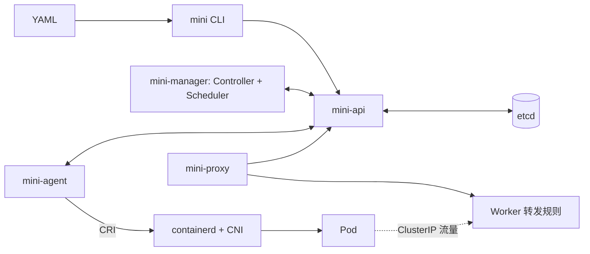

# Mini K8s 实现计划

状态：demo 实施基线，尚未执行验收  
目标：用尽量少的组件跑通声明式容器编排，展示 API、Controller、Scheduler、Agent 与 Service 的协作。  
相关文档：[PRD](PRD.md) · [阶段验收 Gateway](Gateway.md)

## 1. 范围与实施原则

使用 Go、单成员 etcd、containerd CRI、现成 CNI bridge/host-local 与静态路由。部署为单控制平面、两个 Linux Worker；每种控制面组件只运行一个实例。首版只支持 default 命名空间、无状态单容器 Pod、ReplicaSet 和单 TCP 端口 Service，不追求 Kubernetes API 或 kubectl 兼容。

先实现核心闭环，再扩展故障覆盖。保留 UID、resourceVersion/CAS、spec/status 分离、绑定与预留原子提交、按 UID 清理等基本正确性约束。控制器单实例、同一 RS 串行对账；不在初期实现领导选举、领导代次栅栏、通用持久化操作流水或复杂审计补偿机制。创建超时先查询确认，未知时等待重读，不直接重复创建。

**与 PRD 的关系：** 当前 PRD 仍包含领导租约、节点会话代次、全量审计故障门控及 AC01–AC25 全通过等要求。本计划按 demo 范围实施，G1–G5 通过只代表 demo 阶段完成，不代表原 PRD 全部 P0 完成。上述扩展要求保留为后续清单；若按原 PRD 交付，须单独安排实现和验收。不能以本计划静默覆盖 PRD 或声称全部需求已满足。

不新增 Gateway 服务、审批平台或测试框架依赖。Gateway 是五组可重复执行的检查与对应报告，具体判定见 Gateway.md。

## 2. 架构与职责

| 部分 | 职责 | 边界 |
| --- | --- | --- |
| API + CLI | YAML、校验、CRUD、CAS、List/Watch、bind/status | 只有 API 访问 etcd；用户不能写系统状态或绑定 |
| Controller | 按 owner UID 对账 RS，创建和删除 Pod | 不选择节点，不访问 CRI；删除中的 RS 不再创建 Pod |
| Scheduler | 按 requests 过滤节点、绑定与预留 | 事务检查 Pod 未删除且未绑定、Node Ready 且允许调度 |
| Agent | 观察分配、调用 CRI、采集状态、探测、重启与清理 | 只处理本节点和匹配 UID 的资源 |
| Proxy | 根据 Service 与就绪端点安装专用转发规则 | 业务流量不经过 API；清理不影响宿主机其他规则 |

控制面中断时已有容器尽力继续运行，新的调度、变更和状态及时性不保证。失联节点不自动迁移副本；人工恢复节点并对账是 demo 的默认恢复路径。

## 3. 分阶段实施

### 阶段一：最小控制面 → G1

目标：通过 CLI 声明资源，API 校验并持久化。

- 冻结最小 Pod、Node、RS 模型及 Service 预留字段；保留 UID、resourceVersion、owner 和绑定关系，分离 spec/status。
- 实现 CLI apply/get/delete/scale、JSON REST、etcd CRUD、CAS、List/Watch；Pod 运行规格不可原地更新。
- 提供单独的测试客户端模拟 Node/status/bind，复用正式 API 校验，不开放绕过校验的公共测试接口。
- API 先记录结构化请求与操作结果日志，不实现持久化意图及补偿系统。

退出条件：G1 全部检查通过。此阶段不要求真实容器、完整调度或 Service。

### 阶段二：Controller 状态对账 → G2

目标：用真实 API/etcd 和模拟节点状态验证副本收敛。

- 单实例 Controller，按 owner UID 计数，同一 RS 串行处理；List/Watch 驱动并定期全量校正。
- 根据当前差异创建或删除 Pod，缩容先删未绑定 Pod；不认领同标签独立 Pod。
- 未确认停止的已绑定 Terminating/Unknown Pod 仍占额度；删除中的 RS 禁止新增子 Pod。
- 创建结果不确定时先读最新状态确认；重复对账和 Controller 重启不得持续增加副本。

退出条件：G2 全部检查通过。使用测试替身只能证明资源决策正确，不能声称真实运行时链路通过。

### 阶段三：单节点 Agent 与 Runtime → G3

目标：通过受限测试客户端绑定，实际启动和清理容器。

- 预注册一个测试节点，Agent 获取本节点任务，通过 containerd CRI 管理 sandbox 和容器，复用 CNI 插件。
- 本阶段即实现 CPU/内存 limits、状态与日志读取、Always 退避重启以及 Agent 重启后的 UID 对账，避免把本地生命周期全部推迟到最后。
- 按 Pod UID 认领和清理；同名新 Pod 不得误用旧实例；删除完成后释放网络、IP 与预留。
- 记录基本 CRI/CNI 操作结果；运行时固定为 containerd，不并行维护 Docker/cri-dockerd 路径。

退出条件：G3 全部检查通过，证据必须来自真实 Linux/containerd/CNI 环境。

### 阶段四：调度、心跳与两节点闭环 → G4

目标：用户提交 RS 后无需手工绑定即可在两节点运行。

- Agent 心跳每 5 秒一次；控制面在最后有效心跳后 20 秒内标记 Unknown，不再向其调度。
- Scheduler 按 CPU/内存 requests 计算余量，按绑定后 CPU requests/allocatable 最低选择，同分按节点名排序。
- requests 总和不超过 allocatable；limits 总和可超过容量，demo 不保证所有容器同时达到 limits。
- API 原子完成一次性绑定和预留，拒绝对删除中 Pod 或不可调度节点的绑定；停止人工测试绑定路径。
- 配置两节点静态路由，验证跨节点 Pod 双向访问；失联副本保守计数，不自动跨节点替换。

退出条件：G4 全部检查通过。双节点放置通过受控资源配置保证，不把调度评分等同于强制均匀分布。

### 阶段五：Service 与整体演示 → G5

目标：补齐稳定入口、就绪判断及基础恢复，交付完整 demo。

- 先完成 TCP readiness：2 秒一次、超时 1 秒、连续失败两次移除就绪；容器退出立即清除旧 Ready，新容器重新探测。
- 实现单 TCP ClusterIP、selector 与就绪端点，使用项目专用转发链；只在与 API 连通的 Proxy 上承诺规则收敛时间。
- 验证 Agent/manager/API 重启及 etcd 短暂停止后的恢复；节点断线恢复先确认本地实例并重新探测，再恢复就绪端点。
- 交付示例 YAML、安装/清理说明、故障排查步骤、基本操作日志，以及 20 Pod 端到端演示。
- 按 readiness → Service 转发 → 基础恢复 → 整体演示顺序分别验证，避免阶段末一次性集成。

退出条件：G5 及此前各 Gate 在同一最终版本上通过。完整灾备、人工驱逐和 PRD 复杂故障矩阵不作为本次 demo Gate 的前置条件。

## 4. 阶段 Gateway

| Gate | 判断的问题 | 必须使用的环境 | 通过后可进入 |
| --- | --- | --- | --- |
| G1 | 声明是否正确、可靠地保存与读取？ | 真实 API + etcd | Controller |
| G2 | 副本决策能否持续收敛？ | 真实 API/etcd + 模拟状态 | Agent/Runtime |
| G3 | 单节点是否真的运行、恢复并清理容器？ | Linux Worker + containerd + CNI | 多节点调度 |
| G4 | 是否能自动调度并实现跨节点访问？ | 控制平面 + 两个真实 Linux Worker | Service |
| G5 | 用户是否能完整发布、访问、伸缩、恢复和删除？ | 固定两节点环境，20 Pod | demo 完成 |

每个 Gate 的检查 ID、操作、阈值和证据见 [Gateway.md](Gateway.md)。全部必测项 PASS 才能通过；缺环境或未执行为 BLOCKED/NOT_RUN，不能当作通过。不按通过率放行，也不为 demo 增加人工审批系统。

## 5. 共用约束与后续扩展

### 基本正确性与运行环境

- 资源写入使用 CAS；status 更新不覆盖 spec。Pod 绑定只允许从未绑定变为绑定一次，用户不能修改。
- 清理只针对本项目匹配 UID 的运行时与网络资源，不直接修改数据库完成演示。
- etcd 只向 API 开放，CRI socket 仅本机可用。可信内网下使用 TLS 与最小组件身份，拒绝 privileged、hostNetwork、hostPID、hostPath。
- Pod 网段、Service 网段和宿主机网段不重叠。固定依赖版本、镜像 digest 和测试节点配置。
- 记录操作时间、身份、资源 UID、动作与结果，不记录凭据和环境变量敏感值。普通日志足以支持 demo 排障，不宣称完整审计保证。

### 技术选择

Go 标准库 HTTP/CLI 起步，JSON REST，严格 YAML 解码；使用 etcd 官方 Go 客户端、CRI API、containerd 和现成 CNI。队列只实现当前需要的去重、串行处理和退避，不先引入完整 controller-runtime、插件式调度框架或消息队列。具体依赖版本在 G1 前记录。

### 后续扩展，不阻塞 G1–G5

领导选举与代次栅栏、持久化创建操作流水、节点会话代次、人工隔离驱逐、快照灾备、审计意图/结果补偿与磁盘满门控，以及原 PRD 全部 AC 和性能统计，另行排期。

这些能力未实现时必须列入 demo 已知限制。尤其是分区时不保证端点及时更新、不保证旧节点已停机、不承诺 exactly-once 或生产可用。

## 6. 执行与验收记录

先准备 Linux 测试节点、containerd/CNI、可获取的固定镜像与不重叠网段。开发按 G1→G5 推进，每阶段实现对应检查脚本；已有 Go 代码时执行 gofmt、go vet、go test 和构建。初期单条命令/脚本加 Markdown 报告即可，不搭建额外测试平台。

当前仓库只有文档，尚无 Gate 脚本和实现；所有 Gate 初始状态为 NOT_RUN。Gateway.md 中的命令是后续实现约定，不能作为已通过证据。
