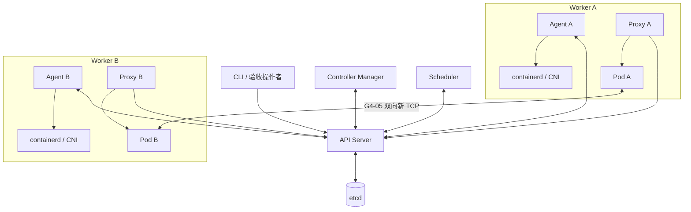
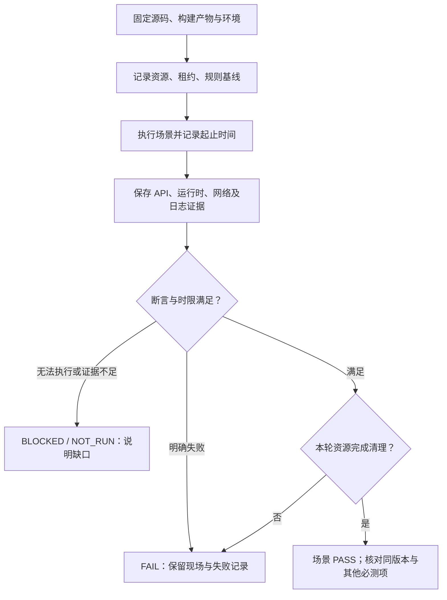
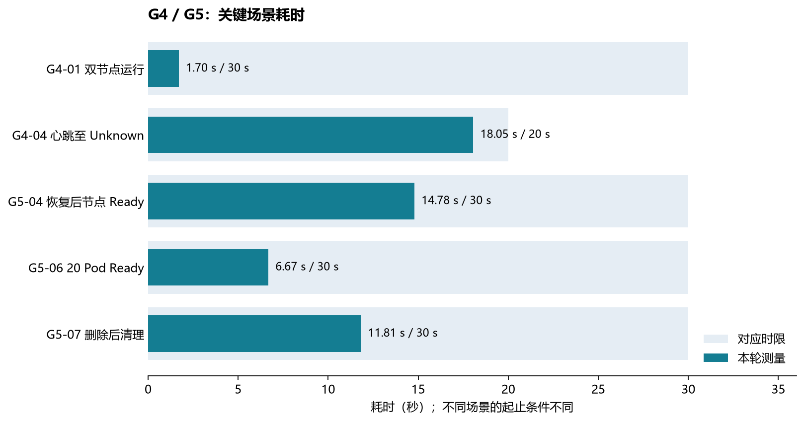
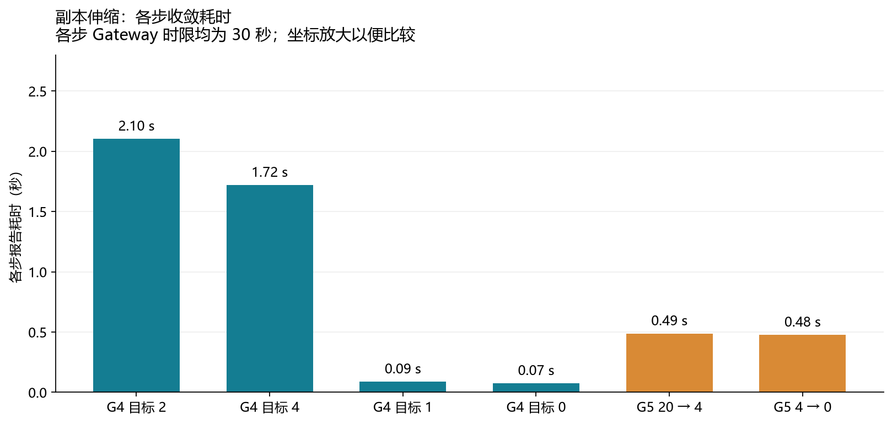
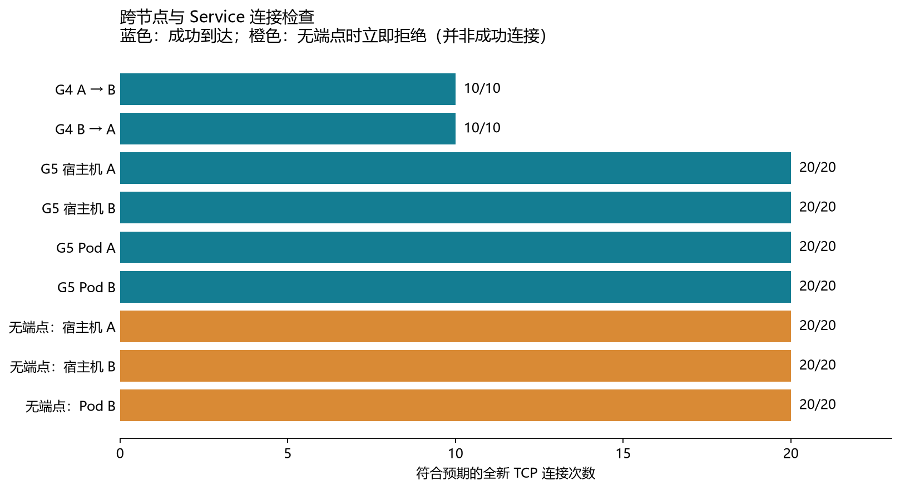

# Mini K8s 阶段验收说明

本文汇总 demo 验收范围、执行顺序和现有记录，方便阅读与交接。具体操作、完整断言和最终通过条件以 [Gateway.md](../Gateway.md) 为准；本文件的图表和历史测量不替代原始证据。

## 阶段与依赖

各阶段只在其全部必测项和清理检查通过后判定 PASS。G5 的最终结论还要求 G1–G4 与 G5 关联同一最终源码版本，并验证安装、示例和排障说明。设计后续模块可以与验收准备并行，但不因此改变 Gate 结论。G1/G2 的模拟节点不能替代真实运行时和双节点测试。

| 阶段 | 核心内容 | 主要检查 |
| --- | --- | --- |
| G1 | API、etcd 和资源协议 | CRUD、持久化、CAS、List/Watch、权限与日志 |
| G2 | ReplicaSet 对账 | 伸缩、重复处理、所有权、丢响应及删除竞态 |
| G3 | 单节点容器生命周期 | 真实运行、Agent 重启认领、自愈、limits、清理 |
| G4 | 双节点调度和网络 | 自动调度、CPU/内存并发、预留释放、失联、双向 TCP、伸缩 |
| G5 | Service 和完整演示 | readiness、端点变化、无端点、重启及 etcd 恢复、失联、20 Pod 和清理 |

## 环境与链路

下图表示逻辑角色；控制面组件和 Worker 的实际部署位置可随测试环境调整。两个 Worker 需分别具备 CRI/CNI 和互通路由，不能以同一节点上的两个 Agent 替代双节点验证。

G4/G5 的目标环境和资源配置见 [Gateway 环境口径](../Gateway.md#2-环境与时间口径)。跨节点路由、IP 转发及防火墙须事先核对；G5 的 ClusterIP 访问另须检查 Proxy 与桥接网络配置。只有 API Server 直接访问 etcd；Worker 的容器生命周期由 Agent 通过本机 CRI 管理。

## 通过判定与证据

每条记录应包含检查 ID、源码提交或源码校验值、二进制哈希、环境与镜像、操作时间、预期、实际、结论、证据路径及清理结果。不同机器的时间需核对时钟偏差；用于证明时限的采样必须在对应窗口内。采集器的成功仅表示采集动作成功，不自动代表场景或 Gate 通过。

## 现有记录摘要

2026-11-05 的 G1–G5 记录关联源码校验 `4933ed318f8dcdb14c36cdc6d37d6696df4cfc59991b5ae3786198008c2e3fb8`。下表与图表描述这份受测源码，后续源码变更的验证以对应运行报告为准。

| 范围 | 记录与当前结论 | 证据或下一步 |
| --- | --- | --- |
| G1–G3 | 该源码校验下的 PASS 记录 | [G1 报告](../artifacts/acceptance/20261105T031346Z-2204431/G1.md)、[G2 报告](../artifacts/acceptance/20261105T031346Z-g2-2203712/G2.md)、[G3 报告](../artifacts/acceptance/20261105T035733Z-g3-2857150/G3.md) |
| G4 | 最新一轮 `g4cur-20261105T053926Z` 的 G4-01–06 均记录 PASS，预检源码校验与 G1–G3 一致 | 双向 TCP 各 10 次成功；node-b 最终 CRI 与租约清单与基线一致。此前路由缺失导致的 G4-05 失败记录保留。 |
| G5 | 最新一轮 `g5cur-20261105T062559Z` 的 G5-01–07 均记录 PASS，预检源码校验与 G4 一致 | 503 后记录 14.8 秒恢复；20 Pod 6.7 秒 Ready；清理记录为 11.8 秒，ClusterIP 声明保留。安装、示例与排障文档的 Worker 步骤仍需确认。 |
| 既有 G5c/G5d | 用户提供过转发、摘除、重新加入、伸缩与清理测量 | 结合 [G5 证据核对](g5-evidence-reconciliation.md)及原件，核对源码、二进制和各自时间窗口后复用；保留不同轮次的限制。 |

G4 和 G5 的原始目录分别为 `g4cur-20261105T053926Z` 与 `g5cur-20261105T062559Z`。测试机上的完整路径及交付条件见 [Gateway 第 9 节](../Gateway.md#9-当前状态)。每轮目录包含 `precheck.json` 的源码校验、`build.json` 的二进制 SHA-256 和 `results.json` 的场景结论。

## 测试数据图表

以下图表是两轮 G4/G5 成功记录的**单次场景数据**，不是多次压测的平均值或百分位。各项目的时间起点和终点不同，不能直接比较成统一性能排名。原始文件位于上一节的测试机证据目录。

G5-04 的 14.78 秒是脚本记录的 etcd 恢复流程中 API 读取、Pod 身份和两节点 Ready 的等待结果；不能仅凭这张图证明所有控制循环细节。G5-07 的 11.81 秒采用该轮脚本的清理判定时间。来源：G4 的 `g401.json`、`g404-window.json`，G5 的 `g504.json`、`g506.json`、`g507.json`；阈值来自 [Gateway](../Gateway.md)。

来源：G4 `g406.json` 的 `marks` 与 G5 `g506.json` 的 `marks`。这些值是脚本在各步观察到的目标运行数量收敛时间；资源彻底清理另看 G4 最终基线和 G5-07。

来源：G4 `g405.json`，G5 `results.json` 和 `g503.json`。无端点场景的 20/20 表示 20 次符合预期的拒绝；三路分别是宿主机 A、宿主机 B 和 Pod B，未采集的 Pod A 没有计入。

生成脚本为 [generate_acceptance_charts.py](../scripts/reporting/generate_acceptance_charts.py)，需要单独提供 matplotlib，不属于项目运行依赖。图中文字是人工整理的证据摘要，原始文件是最终核对依据。

## 测试机信息

下表是 **2026-11-05 16:03 UTC** 前后通过 SSH 只读采样到的宿主机信息，并非从验收记录中证明这些硬件参数在每个历史场景期间都未变化。控制面与 node-a 在本次采样中为同一台机器。

| 项目 | 控制面 / node-a | node-b |
| --- | --- | --- |
| CPU 型号 | AMD EPYC 9965 192-Core Processor | Intel Xeon Silver 4214R 2.40 GHz |
| OS 可见逻辑 CPU | 768 | 48 |
| `/proc/meminfo` 总内存 | 527,402,488 KiB（约 503.0 GiB） | 329,815,616 KiB（约 314.5 GiB） |
| 内核 / 架构 | Linux 6.8.0-139-generic / x86_64 | Linux 5.15.0-176-generic / x86_64 |
| 已采集工具版本 | Go 1.27.3、etcd 3.5.21 | containerd 1.6.21、crictl 1.27.1 |
| Pod 网络 | `10.88.0.0/24` | `10.89.0.0/24` |

这两台机器的实际可见资源高于 Gateway 建议的 2 vCPU / 4 GiB 参考环境。G4 脚本的预检要求节点声明的 allocatable 为 2000m CPU、1 GiB 内存，但这不能证明宿主机物理 CPU、内存或所有进程都被限制到同一额度。因此上面的耗时仅反映本次环境，不应当作参考配置下的性能承诺。

## 已知边界

- 已删除 Service 的 ClusterIP 声明会保留，不计为可立即复用；G5-07 分别检查 Pod CNI 租约、节点预留和转发规则，保留声明须如实记录。
- 节点分区时不保证失联 Proxy 及时摘除端点；会话栅栏不能证明失联节点上的进程已停止。
- 单成员 etcd 与单控制面不提供高可用；demo 通过不等于 [PRD](../PRD.md) 的全部 P0 / AC01–AC25 通过。
- 原始日志、规则和运行时信息可能包含敏感数据；证据应保存在受保护位置，分享前核对并脱敏，令牌和私钥不得纳入报告。

验收操作详见 [G3](g3.md)、[G4](g4.md)、[G5 readiness](g5-readiness.md)、[G5 Service](g5-service.md) 和 [两节点运行与排障](operations.md)。
