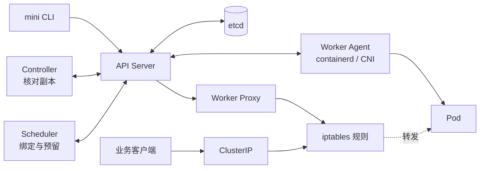
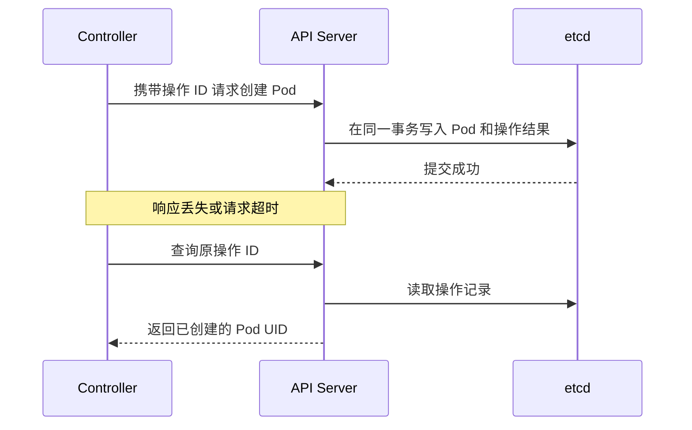

# Mini K8s 项目汇报

我做这个项目，是想把一份 Pod 声明从提交到运行的过程走一遍，再看看每一环出错时，系统还能相信哪些状态。在两台 Linux Worker 上，我用 Go 实现的组件跑通了副本控制、资源调度、容器运行和 ClusterIP 转发。G1～G5 和 API 过载专项已通过，逐项结果和原始记录放在单独的证据页。 [验收结果与证据](mini-k8s-验收结果与证据.md)

## 一份声明如何变成可访问的服务

图里的 Agent 和 Proxy 在两台 Worker 上各运行一份。API Server 读写 etcd，Controller 比较声明的副本数和实际实例数，Scheduler 负责放置，Agent 通过 CRI 让 containerd 执行。Proxy 读到 Service、节点和 Pod 状态后更新 iptables，图中的业务请求由内核规则转发。选择 Go、etcd、containerd 和现有 CNI 插件，是为了把实现集中在这些组件如何交换状态。 [Kubernetes 组件说明](https://kubernetes.io/docs/concepts/overview/components/)

## 实现过程中学到的三个问题

### 1. 创建请求超时后，应该重试什么

Controller 要持续比较期望和实际状态。一轮对账刚发出创建请求，API 响应就可能丢失，但 etcd 已经提交了写入。项目给子 Pod 创建分配操作 ID，在同一事务中写入 Pod 和结果。请求超时后，Controller 用原 ID 查询结果，再决定下一步。调度也遇到类似问题，所以绑定与资源预留在同一事务里完成，避免两个并发请求占用同一份容量。 [Kubernetes 控制器](https://kubernetes.io/docs/concepts/architecture/controller/) · [R1 设计与验收记录](r1-reliability-design.md)

### 2. 节点失联后，旧 Pod 怎么处理

只断开 Worker 的控制连接时，原容器可能继续运行。项目把节点标为 Unknown 后停止向它分配新 Pod，Proxy 从 Service 后端摘除相应端点，Controller 仍计入尚未确认停止的实例。恢复连接后，Agent 要重新探测，Proxy 还要核对节点和 Pod 的就绪代次，避免恢复时沿用断线前的 Ready。Kubernetes 通过 EndpointSlice 表达端点状态，Mini K8s 的 Proxy 在本地从 Service、Pod 和 Node 状态计算后端。 [Kubernetes EndpointSlice](https://kubernetes.io/docs/concepts/services-networking/endpoint-slices/) · [G5 Service 设计](g5-service.md)

### 3. 控制面承压时，哪些请求要保留

R2-A1 为普通 API、Watch 和节点恢复请求分别设在途上限。普通请求超限返回 429，Agent 仍有独立额度上报心跳和处理清理。另一组测试短暂停止 etcd，写请求返回 503，已有转发规则继续处理业务。两组实验分别观察 API 过载和存储中断。 [R2 实施与验收计划](r2-implementation-plan.md)

| 实验 | 观察到的结果 |
| --- | --- |
| API 普通请求过载 | 连续约 6 秒返回 429，期间两台 Agent 的心跳和测试 Pod 清理成功 |
| etcd 暂停 10.1 秒 | 写请求在约 4 秒返回 503，期间 20 次业务连接全部成功 |
| 双节点部署与伸缩 | 20 个 Pod 用时 7.3 秒全部 Ready，稳定运行 5 分钟，随后缩至 4 个、再缩至 0 个 |

## 我怎么和 AI 一起做

我确定每个阶段要回答的问题、通过条件和交付顺序。AI 协助拆分实现、写代码和脚本，按日志和运行记录排查。我协调双节点环境，执行需要交互式 sudo 的操作，再把结果带回来核对。每阶段用独立分支和 PR 交付。

有一次 G5 打印了七条 PASS，末尾却报“上轮请求或应答未清理”。我回传完整输出，AI 对照源码摘要和证据目录，发现脚本在本轮预检失败后又打印了上一轮结果。修复后只重跑 G5，复核新目录的源码摘要、关联的 G4 构建清单和运行锁，才确认通过。这次以后，报告里同时记录场景结果、源码版本和证据目录。 [验收结果与证据](mini-k8s-验收结果与证据.md)

## 当前做到哪里

G1～G5 覆盖控制面、副本控制、单节点运行、双节点调度和 Service。R1 的幂等与并发改进已合并，R2-A1 已完成验收并交由 PR #9 审阅。当前验证范围是一套控制面、单成员 etcd 和两台 Linux Worker，20 Pod 是这套环境下的功能验收样本。下一阶段先测量并约束 API Server 对 etcd 的在途请求，再做控制器队列和 List / Watch 缓存。 [可靠性路线图](reliability-roadmap.md) · [R2-A1 PR #9](https://github.com/Yang-oah/mini-k8s/pull/9)
