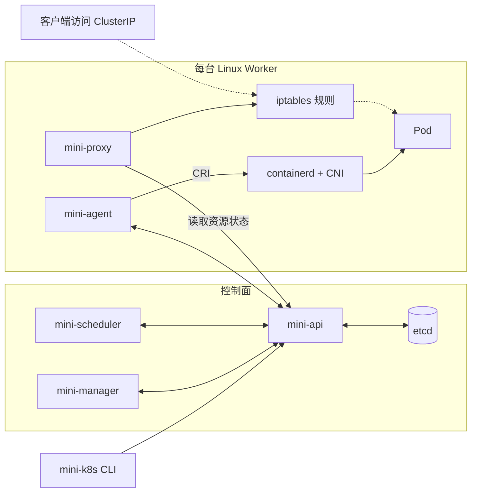
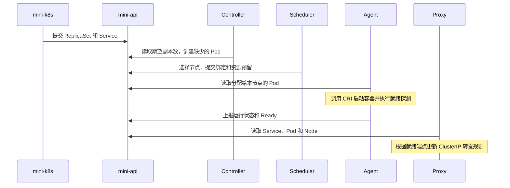

# Mini K8s

Mini K8s 是一个用 Go 写的容器编排实验。仓库里有自定义 API、命令行、控制器、调度器和节点进程。提交一个 ReplicaSet 后，可以沿着代码看它如何创建 Pod、选择节点、启动容器，再通过 ClusterIP 接收流量。

演示环境是一套控制面、单成员 etcd 和两台 Linux Worker。资源范围是 `default` 命名空间下的无状态单容器 Pod、ReplicaSet 和单 TCP 端口 Service。代码中的资源名借鉴 Kubernetes，示例使用仓库自带的 `mini-k8s` 命令。 [与 Kubernetes 的能力对照](docs/mini-k8s-管理层汇报.md#和-kubernetes-相比首版做到哪里)

## 组件怎么连接

API Server 直接读写 etcd，其余组件通过 HTTPS API 交换状态。图中的虚线是业务流量。Proxy 安装 iptables 规则，规则可以把新连接转发到本机或对端 Worker 的就绪 Pod。

## 一次部署怎么走

部署过程中，Pod 绑定和 CPU、内存预留在同一个 etcd 事务中提交。节点失联时，调度器停止向它绑定新 Pod，Proxy 摘除它的端点，Controller 继续计入尚未确认停止的旧实例。 [双节点调度](docs/g4.md) · [Service 设计](docs/g5-service.md)

## 从哪里读代码

可从 [ReplicaSet 示例](examples/g5-replicaset.yaml) 和 [Service 示例](examples/g5-service.yaml) 开始，沿着上图查对应的进程入口和实现。

| 环节 | 进程入口 | 实现 |
| --- | --- | --- |
| 提交声明 | [cmd/mini-k8s](cmd/mini-k8s) | [internal/cli](internal/cli) 解析 YAML、调用 API |
| 存取资源 | [cmd/mini-api](cmd/mini-api) | [internal/api](internal/api) 定义资源和校验，[internal/server](internal/server) 处理身份、资源读写与事务 |
| 管理副本 | [cmd/mini-manager](cmd/mini-manager) | [internal/controller](internal/controller) 按所有者 UID 对账 |
| 放置 Pod | [cmd/mini-scheduler](cmd/mini-scheduler) | [internal/scheduler](internal/scheduler) 按 CPU、内存请求选节点 |
| 运行容器 | [cmd/mini-agent](cmd/mini-agent) | [internal/agent](internal/agent) 管理本节点 Pod，[internal/runtime](internal/runtime) 封装 CRI 操作 |
| 转发流量 | [cmd/mini-proxy](cmd/mini-proxy) | [internal/proxy](internal/proxy) 计算就绪端点、更新 iptables |

## 构建与验收

在仓库根目录用 Go 1.23 或更高版本运行 `go build ./...`。本地开发检查见 [开发指南](docs/development.md)。运行双节点演示需要 etcd、Linux Worker、containerd 和 CNI，配置与启动命令见 [两节点运行与排障指南](docs/operations.md)。

G1～G5 已通过。最近一轮双节点验收中，20 个 Pod 用时 7.3 秒全部 Ready，稳定运行 5 分钟后完成缩容和清理。R2-A1 的过载验证也已通过，普通 API 请求返回 429 时，两台 Agent 仍能上报心跳并完成测试 Pod 清理。 [验收标准](Gateway.md) · [验收结果与证据](docs/mini-k8s-验收结果与证据.md) · [验收脚本](scripts/acceptance)

项目范围和阶段顺序见 [PRD](PRD.md) 与 [Plan](Plan.md)。幂等设计和后续工作见 [R1 设计](docs/r1-reliability-design.md)、[R2 计划](docs/r2-implementation-plan.md) 和 [可靠性路线图](docs/reliability-roadmap.md)。
